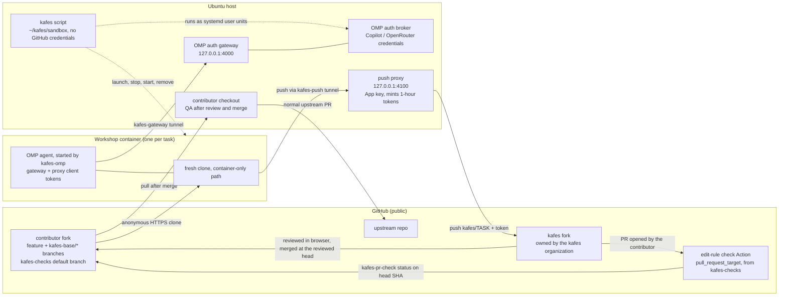
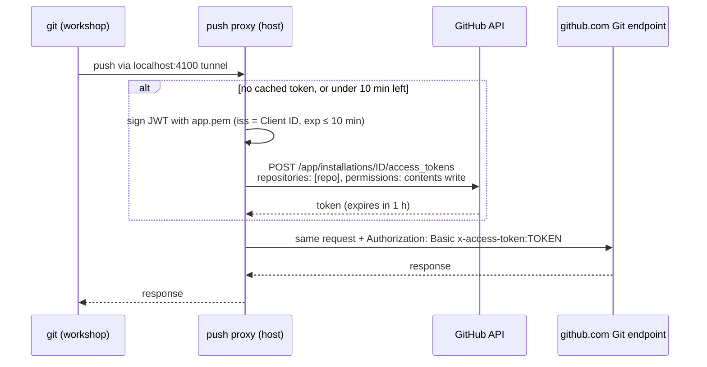

# kafes: specification

kafes ("cage") runs OMP coding agents against an open-source repository so
their changes reach the contributor's host and fork only after review, as
plain text.

> [!NOTE]
> The script, proxy and check are smoke-tested locally. On a laptop, setup
> (including the manual pushes and the ruleset check), task workshop launch,
> its connection and bridge checks, and starting OMP inside the workshop have
> run. Pushing through the proxy and the check on a real agent PR have not. See
> [Open items](#open-items).

Usage: [`kafes.instructions.md`](kafes.instructions.md). Code: [`kafes`](kafes)
(the host script), [`kafes-push-proxy.ts`](kafes-push-proxy.ts) and
[`kafes-pr-check.yml`](kafes-pr-check.yml).

## Principles

- **The agent is an untrusted external contributor.** Its changes go through
  fork-and-PR review.
- **The agent stays in the workshop.** It clones, commits and pushes from
  there. Nothing reaches the contributor's host or fork before review.
- **Credentials stay on the host.** Host proxies add them to requests: the OMP
  auth gateway for model providers, the push proxy for GitHub. The workshop
  holds only short-lived client credentials for those two proxies.
- **kafes holds no GitHub credentials of yours.** It reads GitHub anonymously
  and prints every write for the contributor to do, then checks the result.
- **Review is pinned to one commit.** Only the commit that passed the check and
  the review can be merged.
- **Agent code reaches the host only after review and merge.** The check runs
  on GitHub; review happens in the browser. Host QA starts only once the
  reviewed commit is merged into the contributor fork.
- **Sessions are disposable.** Anything the agent could have touched is
  deleted or rewritten from a trusted copy, not cleaned up.

Placeholders: `<repo>` is the repository name; `<task>` names one agent task;
`<kafes-owner>` is the organization (or machine user) that owns the kafes fork.

## Architecture

## Enforcement points

| Place                       | Controlled by                                                                                              |
| --------------------------- | ---------------------------------------------------------------------------------------------------------- |
| Workshop container          | The agent, during the task. Treated as untrusted.                                                          |
| kafes fork                  | The agent, through the push proxy, while the proxy runs. Treated as untrusted.                             |
| kafes script (host)         | The contributor only. Runs from `~/kafes/sandbox`, outside every agent-writable path.                      |
| Push proxy (host)           | The contributor only. Forwards Git requests; never stores or inspects pushed content.                      |
| Edit-rule check (GitHub)    | The contributor only. Workflow lives on the fork's `kafes-checks` default branch; the agent can't edit it. |
| Contributor fork / upstream | The contributor and the project's existing process                                                         |

## Edit-rule check

A GitHub Actions workflow on the contributor fork. `pull_request_target` runs
workflows from the base repository's default branch, never from the PR, so the
agent can't change the check. It also never lands on feature branches or in
upstream PRs.

### Setup

1. Create a branch `kafes-checks` on the contributor fork containing only
   `.github/workflows/kafes-pr-check.yml`. kafes builds it as a parentless
   commit with fixed metadata, so the same workflow file always gives the same
   commit; the contributor pushes it.
2. Make `kafes-checks` the default branch. Agent PRs target `kafes-base/<task>`
   branches cut from the feature branch; `kafes-checks` is never a PR base or
   head.
3. Add a ruleset on `kafes-base/**` requiring the `kafes-pr-check` status from
   GitHub Actions, with an empty bypass list. Status checks aren't required
   when a branch is created, so the contributor can push new `kafes-base/*`
   branches; merges into them still need the check.

### Workflow rules

| Rule                                                                                                                                                                                                | Why                                                                                                                                                                                                                 |
| --------------------------------------------------------------------------------------------------------------------------------------------------------------------------------------------------- | ------------------------------------------------------------------------------------------------------------------------------------------------------------------------------------------------------------------- |
| Trigger: `pull_request_target` on `opened`, `synchronize` and `reopened`; the job runs only when the PR's head repository is `KAFES_FORK`. A kafes PR with any base other than `kafes-base/*` fails | kafes PRs always get a status, so a mis-targeted one is red. Other PRs, such as the `kafes-base → feature` merge, get none instead of a false failure; the ruleset still blocks a non-kafes PR into `kafes-base/**` |
| Permissions: `contents: read`, `statuses: write`; nothing else (workflow-level `permissions: {}`)                                                                                                   | `pull_request_target` gets a write-capable token; keep it to what posting a status needs                                                                                                                            |
| Never check out or run anything from the PR. Read the diff and commit list through the API for `github.event.pull_request.head.sha`                                                                 | The check treats agent content as data only                                                                                                                                                                         |
| Never put PR-controlled text (title, branch, body, diff) into `run:` with `${{ }}`; read it from the event file or the API                                                                          | PR text can't inject commands                                                                                                                                                                                       |
| Show agent-controlled text only as escaped printable ASCII, with a fixed prefix on every log line                                                                                                   | Paths and emails can't spoof the summary or emit workflow commands                                                                                                                                                  |
| Fail, never pass, on API errors, missing configuration, truncated commit lists or files without a textual diff                                                                                      | A check that can't see everything rejects the PR                                                                                                                                                                    |
| Post `kafes-pr-check` as `success` or `failure` on the head SHA, with the failing rules in the description                                                                                          | Branch protection blocks the merge unless the current head passed                                                                                                                                                   |
| No secrets                                                                                                                                                                                          | Uses only the run's own `GITHUB_TOKEN`                                                                                                                                                                              |

## Push proxy

A small host program that holds the GitHub App's private key, mints
short-lived installation tokens and adds them to the agent's Git requests.
Forwarding and token minting are separate parts. Keep both short: with the
edit-rule check, this is the design's only custom security code.

### One-time setup

1. **kafes organization.** Owns the kafes fork. Use an organization you create
   (default `<user>-kafes`), or a machine user. The account never pushes with
   the App, so an organization avoids a second login with its own 2FA.
2. **kafes fork.** Fork the contributor fork under that organization. Both
   forks stay public: kafes reads them anonymously.
3. **GitHub App,** created under the kafes organization. Naming it after the
   organization makes the commit identity `<kafes-owner>[bot]`:
   - `Contents: read & write` only (`Metadata: read` is implied);
   - no `Workflows` permission, so pushes touching `.github/workflows/**` are
     refused;
   - no `Pull requests` permission;
   - webhook disabled; installable only on this account.
4. **Installation** on the kafes organization, selecting only the kafes fork.
5. **Private key** from **Credentials → Key pairs → New key**. kafes moves the
   download to `~/.config/kafes/push/app.pem`, mode `600`, and deletes the
   original. It records the Client ID and installation ID.
6. **Workshop tunnel** `kafes-push` for `localhost:4100`, defined and connected
   like `kafes-gateway`.

### Per request

### Proxy rules

| Rule                                                                                                                                                                                                | Why                                                                                                                                                        |
| --------------------------------------------------------------------------------------------------------------------------------------------------------------------------------------------------- | ---------------------------------------------------------------------------------------------------------------------------------------------------------- |
| Bind to `127.0.0.1:4100` only; require a random bearer credential, compared in constant time, in addition to the `kafes-push` tunnel                                                                | Loopback alone does not authenticate local processes; only credential holders may use the proxy. Same-user host processes remain trusted.                  |
| Forward only `GET /<kafes-owner>/<repo>.git/info/refs?service=git-receive-pack\|git-upload-pack` and `POST /<kafes-owner>/<repo>.git/git-receive-pack\|git-upload-pack`; `403` for anything else    | Git push and fetch for one repository; no REST API, no other repositories                                                                                  |
| Require `Host` to be `localhost:4100` or `127.0.0.1:4100`, refuse any request carrying `Origin`, and require Git content types on `POST`                                                            | A web page in the contributor's browser can't push through the proxy                                                                                       |
| GitHub URLs are hard-coded. kafes runs it as a systemd user unit in `~/kafes/sandbox` with `bun --no-env-file --config=./bunfig.toml` (settings-free file), passing only identifiers and file paths | No `.env` or `bunfig.toml` preload from another directory can run with the key loaded                                                                      |
| Replace any incoming `Authorization` header with its own                                                                                                                                            | The workshop can't choose which credential is used                                                                                                         |
| Keep the proxy client credential in a mode-600 host file and a URL-scoped Git config inside the workshop; create a new one on every proxy start, delete it when the proxy stops                     | Git sends it only to the local proxy, not to GitHub. It is not a GitHub installation token.                                                                |
| Request each token for the one repository with `contents: write` only, even if the App later gains permissions                                                                                      | The token is never broader than this design needs                                                                                                          |
| Keep tokens in memory only; never log them or request bodies                                                                                                                                        | Tokens and agent code don't land on the host disk                                                                                                          |
| Don't inspect or unpack pushed content                                                                                                                                                              | Unpacking would put agent code on the host before review. The edit rules run on GitHub.                                                                    |
| Retain every unexpired minted token, including predecessors after refresh; on shutdown, stop serving, abort forwarding, await pending minting and revoke all tracked tokens                         | Rotation and shutdown races must not silently lose revocable tokens. Revocation is best effort; failures are logged and exit nonzero, which kafes reports. |
| Limit forwarding to four concurrent requests with five-minute total deadlines, including streaming; bound each mint/revoke operation to 15 seconds and reject API redirects                         | Bound resource use and cleanup duration; cancel upstream requests on client disconnect or shutdown.                                                        |
| Stopped by `kafes task stop` and `kafes task end`, before review starts                                                                                                                             | The agent can't push while its changes are being reviewed                                                                                                  |

Ref names aren't filtered: the agent can push any branch to its fork. That
fork is untrusted; the pinned merge protects the contributor fork.

> [!TIP]
> **Fallback:** the proxy can inject a fine-grained token stored on the host
> instead of minting App tokens. Stock nginx or Caddy header injection plus the
> path allowlist then suffices, but the token is long-lived and the kafes
> account must be a machine user.

## Local rules: Workshop container

| Rule                                                                                                                                                                                                                                                                                                                         | Why                                                                                                                                                                                             |
| ---------------------------------------------------------------------------------------------------------------------------------------------------------------------------------------------------------------------------------------------------------------------------------------------------------------------------- | ----------------------------------------------------------------------------------------------------------------------------------------------------------------------------------------------- |
| One workshop per task, launched from a trusted definition kept in `~/kafes/sandbox`; `workshop remove` when the task ends                                                                                                                                                                                                    | Edits to OMP config, the launcher or the definition can't persist into the next task                                                                                                            |
| Never `workshop refresh` or `workshop restore` a task workshop. `kafes task stop` and `task start` use only `workshop stop` and `start`; `start` first replaces the launch directory's `.workshop/dev.yaml` with the trusted copy, refusing a symlinked `.workshop`                                                          | A refresh or restore would apply an agent-edited definition or reconnect removed plugs                                                                                                          |
| Launch from `~/kafes/tasks/<task>`, holding only `.workshop/dev.yaml`. kafes runs every `workshop` command in a subshell started from there, which exits straight away, and refuses to run from inside `~/kafes/tasks`. Never open it in an IDE or file manager                                                              | The directory is mounted read-write at `/project`, so the agent can plant files there (for example a `.git/` with `core.fsmonitor`, or an `.envrc`). Prompts and shell hooks then never see it. |
| After launch, kafes disconnects the Node SDK's package caches. After launch and after every start, it requires exactly two connections, the `kafes-gateway` and `kafes-push` tunnels; any other connection, or an output line it can't parse, stops it                                                                       | No cache carries state between tasks, and no other plug reaches the host                                                                                                                        |
| Clone into `/home/workshop/src/<repo>`, not `/project`                                                                                                                                                                                                                                                                       | The agent's work stays inside the container; nothing it writes there reaches the host disk                                                                                                      |
| The container can't reach the host or private networks: the `kafes-no-lan` LXD ACL on the Workshop bridge rejects RFC 1918, CGNAT, link-local and IPv6 ULA ranges. Before each launch or start, kafes checks the ACL is still attached, then that the container's address is on that bridge                                  | The only routes to the host are the two tunnels                                                                                                                                                 |
| Clone anonymously over HTTPS from the contributor's public fork                                                                                                                                                                                                                                                              | Cloning needs no credentials                                                                                                                                                                    |
| Push remote `kafes` is `http://localhost:4100/<kafes-owner>/<repo>.git`                                                                                                                                                                                                                                                      | Pushes go through the push proxy                                                                                                                                                                |
| Gateway client token, new on every `task new` and `task start`, granting only the providers the gateway serves out of Copilot, OpenRouter and those the copied settings use; removed from `clients.json` by `task stop` and `task end`                                                                                       | It can spend model quota. It can't reveal provider credentials.                                                                                                                                 |
| Push proxy client credential in a URL-scoped Git config, new on every proxy start                                                                                                                                                                                                                                            | It authorizes Git access to the kafes fork only through the running proxy, not direct access to GitHub.                                                                                         |
| No GitHub credential of any kind: no tokens, credential helper, `gh auth` or SSH keys                                                                                                                                                                                                                                        | Nothing in the workshop can reach GitHub as anyone                                                                                                                                              |
| Host OMP settings copied only from an allowlist (model roles, presets, fallbacks, thinking, compaction except remote endpoints, display). Credentials, any `!command` value, tool, approval, bash and eval settings, extensions, discovery sources and path-scoped entries stay on the host                                  | The agent gets your model setup, not your policy, credentials or host paths                                                                                                                     |
| The agent starts only through `kafes-omp`: `--approval-mode always-ask`, the tools `read,grep,glob,edit,write,bash`, the `kafes-policy.yml` overlay (eval, subagents, browser and LSP denied) and the kafes prompt. `task shell` and `task start` rewrite the launcher, policy, prompt and settings from the host before use | Edits and shell commands need the contributor's approval, and agent edits to those files don't outlive the terminal                                                                             |
| Agent pushes only `kafes/<task>` branches                                                                                                                                                                                                                                                                                    | Convention that keeps one branch per task; not enforced                                                                                                                                         |
| Agent commits as the App bot's noreply identity (`<id>+<kafes-owner>[bot]@users.noreply.github.com`), or a machine user's                                                                                                                                                                                                    | Marks commits as agent-made by convention. The check verifies the email is consistent, not who wrote the code. CLA handling is [TBD](#open-items).                                              |
| Optional: bubblewrap and canaries                                                                                                                                                                                                                                                                                            | Hardening only. On any alert, run `kafes task end`. No cleanup inside the workshop.                                                                                                             |

## Local rules: host

| Rule                                                                                                                                                                                                       | Why                                                                                        |
| ---------------------------------------------------------------------------------------------------------------------------------------------------------------------------------------------------------- | ------------------------------------------------------------------------------------------ |
| kafes runs from `~/kafes/sandbox` (linked as `~/.local/bin/kafes`), copied there by `setup` from the checkout                                                                                              | The script that controls the cage stays outside every agent-writable path                  |
| kafes never pushes and holds no GitHub credentials. It reads GitHub with anonymous Git (no credential helper, no prompt) and the public API, prints each write for the contributor, then checks the result | A bug or compromise in kafes can't write to GitHub as you                                  |
| Broker, gateway and push proxy run as systemd user units bound to loopback; never `--no-auth`                                                                                                              | Provider credentials stay on the host                                                      |
| Push proxy follows the [proxy rules](#proxy-rules); `app.pem` stays on the host, mode `600`                                                                                                                | GitHub credentials stay on the host                                                        |
| Only one task is active at a time. If `task new` or `task start` stops part-way, or is interrupted, it prints the kafes command that cleans up                                                             | Services and credentials are never left behind silently                                    |
| Every `sudo` call in `task new` and `task start` happens first, before anything is started                                                                                                                 | An authentication prompt can't leave a half-built task                                     |
| Never fetch, clone or check out agent commits on the host before merge; don't run the edit rules on the host                                                                                               | Agent content doesn't pass through host tooling before review                              |
| Reviewer confirms `kafes-pr-check` passed on the PR's current head, then reviews in the browser                                                                                                            | The human review and the automated check cover the same commit                             |
| Merge in the browser only while the PR's head is still the commit `kafes task end` printed. The proxy is stopped by then                                                                                   | Nothing the agent pushes later is merged unreviewed; see [Residual risks](#residual-risks) |
| QA on the host only after review and merge: merge `kafes-base/<task>` into the feature branch, pull, then install and test as usual                                                                        | Host execution of agent code happens only on reviewed, merged code                         |

## GitHub rules

| Where                      | Rule                                                                                                                                                                                                                                                          |
| -------------------------- | ------------------------------------------------------------------------------------------------------------------------------------------------------------------------------------------------------------------------------------------------------------- |
| kafes organization         | One per contributor. An organization the contributor owns, or a machine user with 2FA. No membership in the project's org. No write access to anything except its own fork.                                                                                   |
| GitHub App                 | Owned by the kafes organization. `Contents: read & write` only; no `Workflows` or `Pull requests` permission; webhook disabled; installed only on the kafes fork. Private key only on the host.                                                               |
| kafes fork                 | Public. Actions disabled. No secrets, deploy keys, webhooks, or apps other than the push App.                                                                                                                                                                 |
| kafes PR                   | Opened by the contributor from `kafes/<task>` to `kafes-base/<task>`, reviewed in the browser                                                                                                                                                                 |
| Contributor fork, Actions  | Fork-PR workflow runs get no secrets and a read-only token. The only `pull_request_target` workflow is the edit-rule check, which never checks out PR code. Whether an approval click gates kafes PRs is [unverified](#open-items).                           |
| Contributor fork, branches | Public. Default branch is `kafes-checks`, holding only the check workflow. kafes PRs target `kafes-base/*` branches. A ruleset on `kafes-base/**` requires `kafes-pr-check` from GitHub Actions, with no bypass actors, and blocks deletion and force pushes. |
| Contributor fork, merging  | Merge in GitHub at the reviewed head. Then merge `kafes-base/<task>` into the feature branch. Don't check out the agent branch locally.                                                                                                                       |
| Upstream                   | The contributor's normal PR. Agent-made commits keep the kafes identity; CLA handling is [TBD](#open-items).                                                                                                                                                  |

## Edit rules

The [edit-rule check](#edit-rule-check) applies these to the PR's head diff
and commit list. Any failure sets a failing status, which blocks the merge.

### Allowed paths

The check is an allowlist: a change outside it fails. New tooling files
(`vite.config.js`, `vitest.workspace.*`, `postcss.config.*`, `bunfig.toml`,
`index.html`, `public/**`, dependency files) need a human-authored commit.

| Allowed                         | Notes                                       |
| ------------------------------- | ------------------------------------------- |
| `src/**/*.{ts,tsx,scss}`        | Except `src/app/apiclient/**` (generated)   |
| `cypress/e2e/**/*.{ts,feature}` |                                             |
| `cypress/support/**/*.ts`       | Listed for close review                     |
| `docs/**/*.md`                  | `docs/standards/**` listed for close review |

No dotfile or dot-directory is allowed anywhere, even inside these paths.

### Listed for close review

These pass, but the summary lists them for line-by-line review: they run in
every test session or steer later agents.

| Paths                                                 | Reason                                    |
| ----------------------------------------------------- | ----------------------------------------- |
| `src/setupTests.ts`, `src/testing/**`, `__mocks__/**` | Loaded by every test run                  |
| `cypress/support/**`                                  | Loaded by every E2E run                   |
| `docs/standards/**`                                   | Read by agents; a prompt-injection vector |

> [!IMPORTANT]
> Test files under `src/**` run during QA on the host. Review them as code, not
> just as tests.

### Content rules (any path)

| Reject                                                              | Detected by                                                                                                                                                                      |
| ------------------------------------------------------------------- | -------------------------------------------------------------------------------------------------------------------------------------------------------------------------------- |
| Binary files                                                        | Files without a textual patch in the compare API, and `Binary files`/`GIT binary patch` lines in the full diff                                                                   |
| Mode changes, executable bits, symlinks, submodules                 | Any mode other than `100644` in the full diff's headers (`new file mode`, `old mode`/`new mode`, `index … <mode>`); reported as "file mode … (executable, symlink or submodule)" |
| Bidirectional, zero-width or control characters on added lines      | Character scan of added lines, including Unicode tag characters                                                                                                                  |
| Long encoded-looking runs (e.g. over 200 base64/hex characters)     | Pattern scan of added lines                                                                                                                                                      |
| Files or lines too large for GitHub to show inline                  | At most 99 files, 1000 changed lines per file and 500 characters per added line. GitHub's exact collapse thresholds are unconfirmed.                                             |
| Paths with characters outside `A-Z a-z 0-9 . _ @ + , [ ] / -`       | Path scan, including the old path of renames                                                                                                                                     |
| Merge commits, or commits by an identity other than the kafes bot's | The compare API's commit list: parent counts, author and committer emails                                                                                                        |
| A PR whose base isn't a `kafes-base/*` branch                       | The event payload's base ref                                                                                                                                                     |

## Residual risks

- **Logic review.** The rules guarantee every change is plain text visible in
  GitHub's diff, not that it's correct or benign.
- **Reviewed code during QA.** QA runs on the host with your credentials, so a
  backdoor that passes review runs there. It's the same trust as testing a
  colleague's PR, but review is the only control on test files.
- **Dependency changes.** Made by a human, as separate commits.
- **Exfiltration of project data.** The project is public. The agent can reach
  the internet, but not the host or private networks.
- **Look-alike characters.** Homoglyphs (e.g. Cyrillic `а` for Latin `a`)
  aren't detected. 45 tracked files already contain non-ASCII, so a blanket ban
  would need scoping.
- **Fork CI before review.** The fork's `pull_request` workflows can run agent
  code on GitHub-hosted runners before review, with a read-only token and no
  secrets.
- **Workshop control socket.** Reachable inside the container [INFERENCE]; the
  definition holds no secrets.
- **Gateway token.** Spendable until `task stop` or `task end` revokes it.
- **Proxy client token.** Grants the agent's Git access while the proxy runs.
  Any process running as your host user can read it and the App key: the proxy
  is not a same-user isolation boundary.
- **Best-effort revocation.** Network failures, lost mint responses, crashes
  and forced kills can leave installation tokens valid for up to an hour.
  Stopping the proxy ends forwarding, but doesn't guarantee revocation; kafes
  warns when the proxy reports a failed revocation.
- **Merge without a pinned head.** The browser merge has no
  `--match-head-commit`; the reviewer compares the PR head with the commit
  `kafes task end` printed. A token that failed to revoke could still push in
  that window. GitHub rejects a merge whose head changed after the page loaded
  [INFERENCE].
- **Agent files within one terminal.** The agent can edit `kafes-omp`, its
  policy, prompt and settings during a session. kafes rewrites them on
  `task shell` and `task start`, but restarting `kafes-omp` in the same
  terminal loads the edited copies. Plain `omp` in the workshop runs with OMP's
  defaults, which approve every tool call.
- **Pushes during a session.** While the proxy runs, the agent can push
  anything to any branch of its fork. Nothing reaches the contributor fork
  without the check and a reviewed merge. Forks share an object store, so a
  pushed commit is also reachable by SHA under the upstream URL, with a "does
  not belong to any branch" banner: a phishing risk, not a code path.
- **Check workflow token.** `pull_request_target` gets a write-capable token,
  limited by `permissions:` to posting statuses. A bug that ran PR content or
  put PR text in a shell step would hand it to the agent. Keep the workflow
  small and review changes to `kafes-checks` carefully.
- **App private key.** Long-lived, and mints tokens for every repository the App
  is installed on, so keep the installation to the kafes fork. Rotate it if the
  host may be compromised.
- **Workshop environment.** Whether `workshop exec` passes host environment
  variables into the workshop is unverified; kafes sets only the variables it
  needs.

## Open items

- **TBD: CLA and authorship.** Upstream's `cla-check` reads each commit's
  author email and linked login. A machine user shouldn't sign the CLA, so its
  commits fail the check. The check exempts `[bot]` usernames, so App-bot
  commits would pass, but that exemption is meant for automation like
  Dependabot. Attribution must stay honest; the maintainers need to decide.
- **Verify the push proxy against GitHub.** Confirmed on a laptop by setup's
  check: the proxy starts, mints an App token, and serves an authenticated
  `git ls-remote` of the kafes fork from the host. Pushes, the concurrency
  limit, streaming cancellation, token rotation and shutdown have run only
  against a local stand-in or not at all. Still to confirm:
  - A push through the proxy with `x-access-token` Basic auth succeeds.
  - A push changing `.github/workflows/**` is refused.
  - Requests for any other repository or path get `403`.
  - A large push through the Workshop tunnel doesn't time out.
  - `DELETE /installation/token` revokes the current token.
  - URL-scoped proxy authentication works through the Workshop tunnel, and
    unauthenticated requests are refused.
  - Shutdown cancels active transfers and revokes tokens minted before and
    during shutdown; simulated network failures produce a nonzero exit.
- **Verify the edit-rule check on GitHub.** Confirmed on a laptop: GitHub
  Actions becomes the required-status source after the dummy PR, and the rules
  API reports the ruleset as `kafes` requires (`integration_id` 15368,
  `do_not_enforce_on_create`), since setup's ruleset check passed. The rules
  themselves have run only against fixtures and a local stand-in API. Still to
  confirm:
  - A `pull_request_target` run triggers when the contributor opens the PR,
    without an approval click.
  - A status posted with the run's `GITHUB_TOKEN` satisfies the required-status
    rule.
  - The compare API between the base commit and a kafes-fork head commit works
    from the contributor fork's side.
  - The real API's output for binary files, mode changes and large diffs
    matches what the check expects.
  - With the required status pinned to GitHub Actions and an empty bypass
    list, the admin can't merge past it.
  - The new allowlist doesn't reject paths ordinary agent work needs.
- **Verify the Workshop isolation.** Confirmed on a laptop: `workshop
connections` output, cache-plug disconnection, the two tunnels connecting
  and the container's address on the ACL bridge. Still to confirm:
  - The `kafes-no-lan` ACL blocks the host and private ranges, and still allows
    the two tunnels and internet egress.
  - `workshop stop` and `start` keep the caches disconnected and the files,
    sessions and packages in place.
  - Whether `workshop remove`, `connect`, `connections` or `start` re-read an
    agent-edited `.workshop/dev.yaml` from the launch directory.
  - Copied host settings route through `pi-native` for providers other than
    Copilot and OpenRouter.
- **Verify the CI approval gate.** GitHub's approval setting for outside
  collaborators may depend on who triggers the run. You open kafes PRs, so it
  may never apply. Runs still get no secrets and a read-only token.
